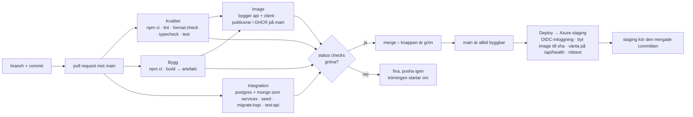

# Pipeline – Utpost

*Exempelifyllt facit (M1, utbyggt t.o.m. M6). Tider är från en riktig körning på mallrepot – teamen fyller i sina egna.*

## Flödet

## Vad som körs, och varför

| Steg | Kommando | Fångar | Tar |
|---|---|---|---|
| Lint | `npm run lint` (ESLint på `client/`) | oanvända variabler, fel i Vue-templates, `no-undef` | ~4 s |
| Format | `npm run format:check` (Prettier, bara kontroll) | filer som inte kördes genom Prettier – ändrar inget i CI, det gör man lokalt | ~2 s |
| Test | `npm test` (`vitest run`) | ett röktest på guidevyn den här veckan (M1) – riktiga tester i M2 | ~3 s |
| Bygg | `npm run build` (`vite build` av `client/`) | importfel, trasiga templates, allt som bara syns vid bygge | ~2 s |
| Typkontroll (M2, M5) | `npm run typecheck` (codegen + `vue-tsc` + `tsc`) | ett fält som tagits bort ur schemat men används i en vy – kedjan schema → fråga → vy | ~10 s |
| Integration (M5) | `npm run test:api` mot Postgres och Mongo som *services* | resolvers som inte stämmer med databasen, N+1 som kommit tillbaka, mutationer utan inloggningskrav – det klientens mockade tester aldrig ser | ~40 s inkl. start av databaserna |
| Deploy (M6) | `az containerapp update … --image …:sha-…` ×2 (api, client – två revisioner per deploy), vänta på `sha` i `/api/health` och på sista revisionen, röktest `/graphql` | en image som inte startar, en nginx-mall som inte renderas, en app som inte kommer upp – innan någon användare ser det | ______ (bara på `main`; väcks appen från noll tillkommer ~1 min) |
| Image (M4) | `docker/build-push-action` på `api/Dockerfile` och `client/Dockerfile` | en Dockerfile som inte går att bygga; på `main` publiceras imagerna med `sha-`tagg | ~1,5 min |

`npm ci` (~25 s) dominerar – den installerar alla tre workspaces inklusive React-klientens beroenden. När `web/` tas bort (M6) halveras tiden.

## Branch protection (ruleset på `main`)

- Kräver PR – ingen pushar direkt till `main`
- Kräver status checks **Kvalitet**, **Bygg**, **Integration** och **Image** gröna innan merge
- Kräver att branchen är uppdaterad mot `main` före merge (annars testas en kod som aldrig kommer att finnas)
- Gäller även admins
- *Deploy → Azure staging* är **inte** en status check: den körs efter merge, på `main`. Blir den röd är `main` ändå korrekt – det är staging som inte uppdaterades. Rätta och merga igen, eller rulla tillbaka med `az containerapp update … --image <förra sha-taggen>` (varje image i GHCR har sin sha-tagg kvar).

## Vanliga fel vi sett

- **Grönt lokalt, rött i CI:** `npm run lint` lokalt är samma kommando som i CI. Kör det innan du pushar. Skillnaden brukar vara en fil som inte är sparad, eller `--fix` lokalt som gömde felet.
- **`format:check` rött:** kör `npm run format --workspace=client` och committa. CI ska aldrig ändra kod, bara säga nej.
- **Status check heter fel i rulesetet:** namnet är jobbets `name:` (Kvalitet, Bygg, Integration, Image) – inte filnamnet.
- **Integration rött men testerna gröna lokalt:** databasen i jobbet är tom tills `npm run seed` körts, och `Tour.logs` läser Mongo – `npm run migrate:logs` måste också ha körts. Portarna är `5432`/`27017` på `localhost` i jobbet, inte `5433` som i compose.
- **Deploy rött med *AADSTS700213 No matching federated identity record*:** subjectet stämmer inte. Felmeddelandet skriver ut det subject GitHub skickade – skapa en federerad identitet till med exakt det värdet (`az ad app federated-credential create`, nytt `name`). Jobbet måste också ha `environment: azure-staging`.
- **Deploy rött på *Vänta tills staging kör den här committen*:** appen startar från noll (fyra containrar + seed, ~1 min) – 30 försök à 10 s brukar räcka. Står `sha` kvar på det gamla värdet efter fem minuter: revisionen startade inte. `az containerapp logs show --name utpost-staging --resource-group utpost-rg --container api --tail 50`.
- **Deploy rött på röktestet men väntan grön:** `/api/health` svarar genom nginx (så `API_UPSTREAM` är rätt), men GraphQL ger ingen data – databasen är tom (`SEED_ON_START` saknas eller seeden misslyckades: `az containerapp logs show … --container api`). Är det väntan som är röd med `502`/inget svar är det nginx som inte når api: `API_UPSTREAM` ska vara `localhost:4000` i Azure.
- **Deploy rött på *revision already exists*:** jobbet kördes om (Re-run) och revisionssuffixet `sha-<7>` är redan använt. Suffixet är commitens sha, så vägen framåt är en ny commit – inte Re-run.
- Loggkommandona nedan har mallens namn (`utpost-staging`, `utpost-rg`) – byt till era.
